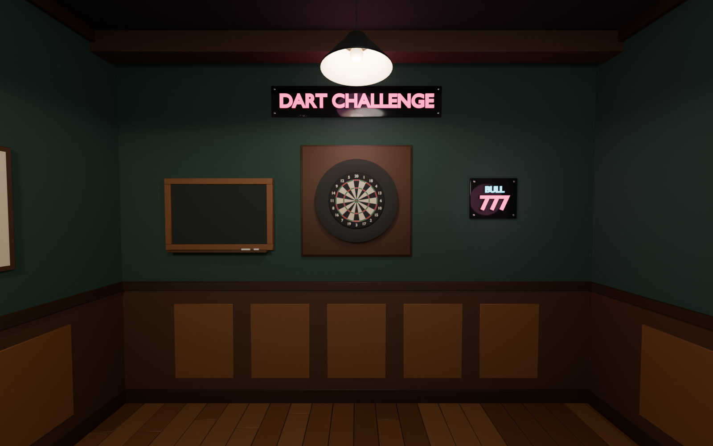

# E1. 채용 담당자용 — 포트폴리오 요약 카드 (v0.2)

## 작성 메모 (본문 아님)

```
독자:      H1 채용 담당자 (비개발)
읽는 목적: 기술 면접에 넘길지 판단
읽는 상황: 포트폴리오 PDF를 훑음, 30초
아는 것:   게임은 앎. Unity · XRI 같은 이름은 공고에서 본 정도
성공 기준: "무엇을 완성했고, 어디까지 직접 했고, 어떻게 일하는 사람인지"를 말할 수 있다
```

**라운드 1에서 바꾼 것**
- 손 추적을 넣은 뒷이야기를 뺐습니다. 기능 하나의 과정은 사용자가 강조하려는 것도, 채용 담당자가 확인하려는 것도 아니라는 피드백(F1-1)을 따랐습니다.
- 그 자리에 **완성한 결과물, 직무와 맞는 기술, 직접 만든 범위, AI와 일하는 방식**을 넣었습니다. 이 네 가지는 Claude의 가정입니다.
- 본문은 사용자가 직접 쓴 글처럼 1인칭과 ~습니다 체로 썼고, `[확인 필요]` 표시는 본문에서 뺐습니다.

**본문에서 뺀 것 — 확인해 주세요**
- 채용 담당자에게 가장 먼저 보여 주고 싶은 것이 무엇인지. 위 네 가지가 맞는지 알려 주세요.
- 혼자 만들었는지 팀으로 만들었는지 (커밋에 다른 작성자가 1건 있습니다)
- 시연 영상 링크, 그리고 1차 빌드를 실제로 제출했는지 (제출했다면 "완성해 제출했습니다"로 더 힘 있게 쓸 수 있습니다)
- 이미지는 에셋 미리보기 렌더입니다. 실제 플레이 화면으로 바꾸는 것이 좋습니다.
- "직접 작성"의 범위는 커밋의 `AI-Assist` 태그를 근거로 했습니다.

---

## 본문

### 다트 챌린지 — Meta Quest VR 물풍선 다트



다트를 집어 던져 공중에 떠오른 물풍선을 터트리고, 60초 안에 목표 점수를 넘기는 VR 게임입니다. 계속 움직이는 작은 금빛 풍선을 맞히면 777점을 받습니다. 2026년 11월 16일 기획부터 23일 1차 빌드 제출까지, 8일 동안 만든 게임입니다.

| 기간 | 플랫폼 | 사용 기술 |
| --- | --- | --- |
| 2026.11.16 ~ 11.23 (8일) | Meta Quest | Unity 6 (URP), XR Interaction Toolkit 3.5, OpenXR, 손 추적(XR Hands), DOTween |

게임이 돌아가는 핵심 코드는 제가 직접 작성했습니다. 시작부터 60초 타이머와 종료까지 이어지는 게임 흐름, 점수와 콤보 화면, 풍선을 만들어 내는 부분, 다트를 잡고 던지는 코드가 여기에 들어갑니다. 기간 안에 직접 만들기 어려운 3D 모델과 터지는 효과, 소리는 AI 생성 도구로 만들었고, 미리보기를 보며 제가 하나씩 검토했습니다.

AI와는 맡길 일과 제가 정할 일을 나눠서 일했습니다. 설계를 골라야 할 때마다 AI에게 선택지와 근거를 받고, 결정은 제가 내렸습니다. 그 과정을 결정 기록 7건과 개발 일지로 남겼고, 커밋마다 AI가 쓴 코드인지 제가 쓴 코드인지 표시해 두어서 어느 부분이 제 작업인지 바로 확인하실 수 있습니다.
