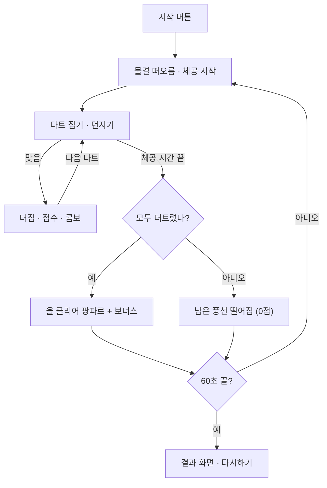

# XR 물풍선 다트 — 컨셉 기획서

Nov 16, 2026 · @CSD (개정: 다트판 버전 → 물풍선 버전, 결정 기록 [002](../decisions/002-물풍선-기획-전환.md))

## 1. 프로젝트 개요

주제 B(XRI를 활용한 VR 게임)로, 제자리에 서서 다트를 집어 던져 공중에 떠 있는 물풍선을 터트리고, 60초 안에 목표 점수를 넘기는 짧은 VR 게임을 만든다.

| 항목 | 내용 |
| --- | --- |
| 앱 이름 | 다트 챌린지 (가칭) |
| 선택 주제 | 주제 B. XR Interaction Toolkit을 활용한 VR 게임 |
| 플랫폼 | Meta Quest (Android APK 빌드) |
| 개발 도구 | Unity, OpenXR + Unity OpenXR: Meta, XR Interaction Toolkit |
| 환경 | 야외 여름 계곡 |
| 기간 | 5일 +@ |
| 컨셉 기획서 제출 | Nov 16, 2026 |
| 1차 빌드 · 시연 영상 제출 | Nov 23, 2026 |

## 2. 무엇이 바뀌었나

목표물이 벽의 다트판에서 **공중에 잠시 떠 있는 물풍선**으로, 배경이 실내 다트 바에서 **야외 여름 계곡**으로 바뀐다. 다트를 집어 던지는 조작과 제자리 플레이는 그대로다.

| 구분 | 이전 기획 | 수정안 |
| --- | --- | --- |
| 목표물 | 벽의 다트판 | 일정 시간 공중에 떠 있는 물풍선 (색마다 크기·거리·점수가 다름). 다트판은 없앰 |
| 점수 | 꽂힌 섹터 점수 | 터트린 풍선 점수 + 한 번에, 또는 빠르게 여러 개를 터트린 콤보 |
| 777점 | 다트판 정중앙 | 계속 움직이는 작은 금빛 물풍선, 언제든 도전 가능 |
| 끝나는 조건 | 다트 7개를 다 던지면 끝 | 60초가 지나면 끝, 다트는 다트통에 자동으로 채워짐 |
| 핵심 경험 | 다트가 꽂히는 손맛 | 연달아 터지는 소리와 물이 쏟아지는 시원함 |
| 환경 | 실내 다트 바 | 야외 여름 계곡 |
| 그대로 | 잡기·던지기, 제자리 플레이, 다트·다트통·UI 패널 | 같음 |

## 3. 한 줄 소개 · 핵심 경험

**한 줄 소개:** 공중에 떠오른 물풍선을 다트로 꿰뚫어, 한 번에 혹은 연달아 터트리며 점수를 쌓는 VR 다트 게임.

**핵심 경험 (이것 하나는 확실히 된다):** 던진 다트 하나가 일렬로 선 풍선들을 꿰뚫고 지나가며 물풍선들을 터트리는 쾌감.

마리오의 코인처럼 시원하고 중독적인 느낌을 위해 세 가지를 지킨다.

1. **즉각:** 터지는 순간 0.1초 안에 소리·물·점수가 한꺼번에 나온다.
2. **상승:** 연달아 터트릴수록 소리 높이·점수·연출이 커진다.
3. **보상:** 한 물결의 풍선을 모두 터트리면 팡파르 사운드를 낸다.

마리오는 느낌의 목표로만 삼는다.

- 플레이어는 제자리에서만 플레이한다. 움직이는 것은 풍선뿐이다.
- 한 판은 짧고, 결과가 분명하게 나온다.

## 4. 게임 규칙과 흐름

60초 동안 물결(웨이브) 단위로 떠오르는 풍선을 터트려, 끝났을 때 누적 점수가 목표 점수 이상이면 승리, 미만이면 패배다.

1. **준비:** 플레이어는 던지는 선 뒤에 서고, 오른쪽 테이블에 다트통이 있다. 시작 버튼을 레이로 누른다.
2. **물결:** 풍선 여러 개가 정해진 대형(일렬 포함)으로 차례대로 떠올라 정해진 시간 동안 공중에 머문다.
3. **던지기:** 다트는 풍선을 터트리고도 멈추지 않고 계속 날아간다. 일렬로 선 풍선을 한 번에 꿰뚫을 수 있다. 던진 다트는 다트통에 자동으로 다시 채워진다.
4. **점수:** 터트린 풍선 점수에 콤보 배율을 곱한다 (6장).
5. **물결 끝:** 모두 터트리면 보너스 사운드, 시간이 다되면 남은 풍선은 떨어져 사라진다. 다음 물결이 떠오른다.
6. **결과:** 60초가 지나면 승리/패배와 최종 점수를 보여주고, 다시하기 버튼으로 재시작한다.

| 규칙 | 값 (예시) |
| --- | --- |
| 게임 시간 | 60초 |
| 목표 점수 | 300점 |
| 다트 | 다트통에 자동으로 채워짐 (개수 제한 없음) |
| 승리 조건 | 60초가 끝났을 때 누적 점수가 목표 점수 이상 |
| 패배 조건 | 60초가 끝났을 때 누적 점수가 목표 점수 미만 |



60초가 되면 물결 중간이라도 바로 결과 화면으로 간다. 금빛 풍선은 이 흐름과 별개로 게임 내내 움직이며, 언제 맞혀도 777점이다.

## 5. 물풍선 종류

작고 멀고 많이 움직일수록 점수가 높다. 일반 풍선 3색은 물결마다 떠오르고, 금빛 풍선은 게임 내내 떠다닌다. 아래 값을 첫 플레이테스트 값으로 쓴다.

| 색 | 지름 (cm) | 던지는 선에서 거리 (m) | 점수 | 움직임 | 등장 |
| --- | --- | --- | --- | --- | --- |
| 빨강 | 35 | 1.2 ~ 1.5 | 10 | 떠오른 뒤 거의 멈춤 | 물결마다 |
| 파랑 | 28 | 1.5 ~ 1.8 | 20 | 떠오른 뒤 거의 멈춤 | 물결마다 |
| 초록 | 22 | 1.8 ~ 2.0 | 30 | 떠오른 뒤 거의 멈춤 | 물결마다 |
| **금빛** | **12** | 1.5 ~ 2.0 | **777** | 끊임없이 큰 곡선(8자 등)으로 이동 | 항상 1개, 터지면 잠시 뒤 다시 나타남 |

- **체공:** 일반 풍선은 아래에서 떠오른 뒤 정해진 시간(예: 6초) 머물고, 그 안에 못 터트리면 떨어지며 사라진다 (0점).
- **일렬 대형:** 물결마다 몇 개의 풍선이 던지는 방향으로 겹쳐 서서, 한 번에 꿰뚫을 수 있는 ‘줄’이 생긴다.

## 6. 점수 계산

콤보 카운터 하나로 ‘한 번에’와 ‘빠르게 여러 번’을 함께 처리한다. 직전 터짐에서 1.5초 안에 또 터트리면 콤보가 1 오른다. 한 다트로 꿰뚫은 풍선은 거의 동시에 터지므로 자연스럽게 콤보가 된다.

```
얻는 점수 = 풍선 점수 × min(1 + 0.5 × (콤보 − 1), 3)
```

| 콤보 | 1 | 2 | 3 | 4 | 5 이상 |
| --- | --- | --- | --- | --- | --- |
| 배율 | ×1 | ×1.5 | ×2 | ×2.5 | ×3 (최대) |

- **예시:** 다트 하나로 빨강 → 파랑 → 초록을 꿰뚫으면 10×1 + 20×1.5 + 30×2 = 100점.
- **올 클리어:** 한 물결의 풍선을 모두 터트리면 보너스 +50점 (예시).
- **금빛 풍선:** 배율 없이 항상 777점 (숫자가 상징이 되도록). 콤보 카운터는 올린다.
- 콤보가 끊기면 배율은 ×1로 돌아간다.

## 7. 피드백 설계

터짐의 크기에 따라 피드백을 4단계로 키운다. 가장 큰 연출은 올 클리어와 금빛 풍선에만 쓴다.

| 순간 | 소리 | 눈 | 손 (햅틱) |
| --- | --- | --- | --- |
| 풍선 하나 터짐 | 짧은 ‘팡’ + 물 튀는 소리 (0.3초 이내) | 고무 조각과 물방울이 튀고, 그 자리에 점수 숫자가 떠오름 | 짧고 약한 진동 |
| 연속 터짐 (콤보) | 같은 ‘팡’이 콤보마다 한 음씩 높아짐 (최대 8단계) | 콤보 숫자가 점점 커지고 색이 진해짐 | 콤보마다 조금씩 강해짐 |
| 물결 올 클리어 | 짧은 팡파르 | 풍선이 있던 자리 위에서 물이 한꺼번에 쏟아지고 바닥에 물보라 | 길고 묵직한 진동 |
| 금빛 풍선 | 듣기 좋은 청각적 쾌감이 있는 차별화된 ‘팡’ 소리 + 동전이 쏟아지는 듯한 소리 | 금빛 반짝이 폭발, 큰 ‘777’ 글자 | 가장 강한 진동 |

- **중독성의 핵심:** 기본 소리는 늘 같고 높이만 바뀐다. 귀가 소리를 익히면 다음 음을 기대하게 된다.
- **짧게:** 소리가 짧아야 빠르게 연달아 터져도 지저분하게 겹치지 않는다.
- **물은 플레이어 앞 바닥으로:** 물이 시야를 덮으면 불쾌하고 멀미를 부를 수 있다.

## 8. XR 기능과 기술 포인트

XRI 상호작용은 이전 기획과 같다. 새로 어려워지는 곳은 ‘다트가 멈추지 않고 풍선을 뚫고 지나가는’ 판정이다.

| XR 기능 | 쓰임새 | 우선순위 |
| --- | --- | --- |
| 잡기 (Grab) | 다트통에서 다트 집기 | 필수 |
| 던지기 (Throw on Detach) | 놓는 순간 손의 속도로 다트 날리기 | 필수 |
| 레이로 UI 누르기 | 시작 / 다시하기 버튼 | 필수 |
| 햅틱 (컨트롤러 진동) | 터짐·콤보·금빛 피드백 | 선택 |
| 소켓 (Socket) | 다트통에 다트가 꽂힌 상태 | 선택 |

- **관통:** 풍선 콜라이더를 Trigger로 두면 다트가 튀지 않고 지나가면서 터트릴 수 있다.
- **빠른 다트가 작은 풍선을 건너뛰는 문제:** 한 프레임에 풍선 지름보다 멀리 날면 충돌을 놓칠 수 있다. 특히 12 cm 금빛 풍선. 구현 때 충돌 감지 방식을 테스트로 확인한다.
- **다트 채우기:** 던진 다트만큼 다트통에 새 다트가 채워져야 한다. 방식은 구현 때 정한다.
- **성능:** 물 쏟아짐 파티클은 Quest에서 무거워질 수 있다. 파티클 수에 상한을 둔다.

## 9. 작업지시서 요구사항 체크

| 요구사항 | 이 기획에서 |
| --- | --- |
| XRI 상호작용 2종류 이상 | 잡기 + 던지기 (+ 레이 UI, 햅틱, 소켓) |
| 시작 → 플레이 → 끝 흐름 | 시작 버튼 → 60초 동안 물결 → 승리/패배 결과 화면 |
| 점수·시간·승패 중 1개 이상 | 점수 + 시간 + 승패 |
| Quest에 APK로 설치해 실행 | 단일 씬 |
| 중간에 튕기거나 멈추지 않음 | 파티클 수 상한, 단순한 구조 유지 |
| 멀미 고려 | 제자리 플레이, 움직이는 것은 풍선뿐, 물이 시야를 덮지 않음 |

## 10. 확정 사항 (2026-11-16)

- 끝나는 조건: **60초 시간 제한**, 다트는 다트통에 자동으로 채워짐
- 승패: 목표 점수를 두어 승리·패배를 낸다 (예: 300점)
- 풍선 값: 5장의 크기·거리·점수·체공 시간을 첫 테스트 값으로 쓴다
- 콤보: 하나의 콤보 카운터
- 금빛 풍선: 콤보 배율 없이 777점 고정
- 다트판: 없앰
- 환경: 야외 여름 계곡 (다른 컴퓨터에서 제작해 적용)
